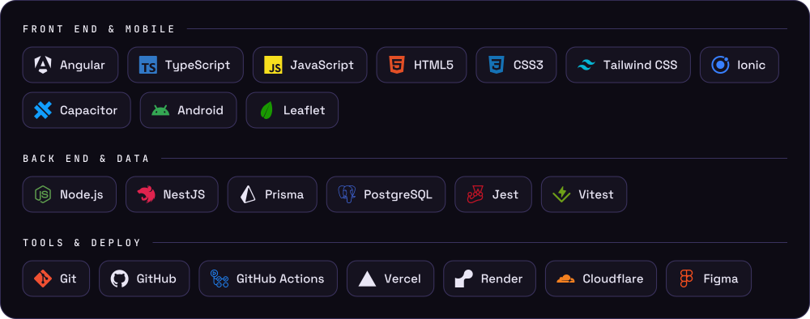

<!-- Perfil de GitHub de DrMunty. Va en el repositorio público DrMunty/DrMunty, en la raíz, como README.md -->

<div align="center">




</div>

<br>

## About me

I'm a full-stack developer who likes to take a product from the idea to production: design, API, mobile app, tests and deploy. My main project, **LightWeight**, is a real fitness product with a mobile app, a REST API, a trainer-client marketplace and a chat, and it is being prepared for the stores.

- I write the **tests first** and keep the logic in small **pure functions**, so the components only render.
- I care about the details that make an app feel finished: safe areas on notched phones, no overflow at 320 px, accessible labels, dark mode.
- I review my own diffs before anyone else sees them, and I keep one branch per feature with a clean history.

<br>

## Featured project

<div align="center">

<a href="https://beastmode-fitnessapp.vercel.app">
  
</a>

</div>

**LightWeight** is a mobile fitness app for people who train and for the coaches who guide them.

| | |
|---|---|
| **Routines** | Creation wizard (sets, rep range, rest and RIR per set), weekly calendar, guided workout with rest timer, and a draft that survives closing the app |
| **Progress** | Session history, per-exercise evolution and weekly volume per muscle group |
| **Coaching** | Clients find a trainer and hire a service; trainers manage clients, requests and routines; chat with text and photos |
| **Admin** | Verification of trainers' qualifications and refunds |
| **Nearby gyms** | Map of gyms around you, built on OpenStreetMap data |
| **Native** | Android and iOS with Capacitor, local notifications for the rest timer |

<!--
  Cuando hagas públicos los repositorios, descomenta esto para mostrar sus tarjetas:

<div align="center">
<a href="https://github.com/DrMunty/beastmode-fitnessapp">
  
</a>
<a href="https://github.com/DrMunty/beastmode-backend">
  
</a>
</div>
-->

<br>

## Architecture

<div align="center">



</div>

<br>

## Tech stack

<div align="center">



</div>

<br>

## GitHub stats

<div align="center">


</div>

<br>

## How I work

```text
 idea ─► mockup ─► failing test ─► minimal code ─► type check ─► self review ─► PR ─► production
```

- **Branch per feature**, small pull requests, and a CI that runs install, type check, tests and build on every PR.
- **Pure functions first**: business rules live in `*.util.ts` files with their own specs; components stay thin.
- **Mutation checks** on the rules that matter, so a green test really means something.

<br>

## Let's connect

<div align="center">

<a href="https://github.com/DrMunty"></a>
<a href="https://www.linkedin.com/in/TU-USUARIO/"></a>
<a href="mailto:al96@hotmail.es"></a>

<br><br>


</div>
