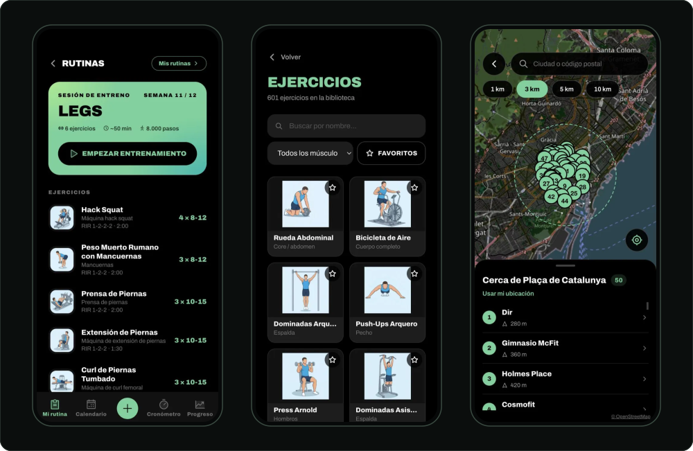
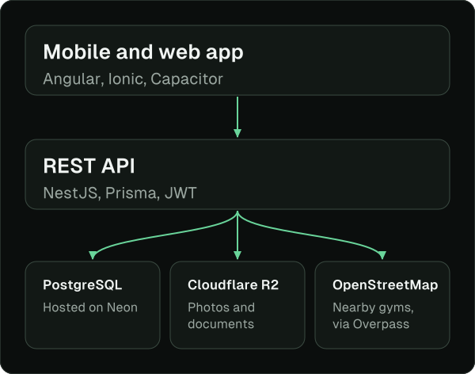

<!-- GitHub profile README for DrMunty. It lives in the public repository DrMunty/DrMunty, at the root, as README.md -->

I’m building **LightWeight**, a training and coaching app, end to end: an Angular and Ionic front end, a NestJS API and a PostgreSQL database.

Today’s session, the exercise library and the nearby gyms map. The app is in Spanish.

## LightWeight

A mobile app for people who lift and the coaches who work with them. A short questionnaire builds the plan (sets, rep range, rest and RIR, or reps in reserve, per set), a weekly calendar schedules it, and a guided workout with a rest timer runs each session. It also charts weekly volume per muscle group, lets clients find and hire a coach who builds and adjusts their routines, and maps gyms nearby from OpenStreetMap data.

Try the live demo at [beastmode-fitnessapp.vercel.app](https://beastmode-fitnessapp.vercel.app). I’m packaging the app for Android and iOS with Capacitor. The repositories are private for now, so if you’d like to see the code, write to me.

## How It’s Built

- **Front end:** Angular, Ionic, Capacitor, Tailwind CSS
- **Back end:** NestJS, Prisma, PostgreSQL
- **Tests:** Vitest on the front end, Jest on the API, plus end-to-end tests over HTTP
- **Deploy:** Vercel, Render, Neon, Cloudflare R2, GitHub Actions

## How I Work

- The rules that matter (calculations, permissions, edge cases) are pure functions with their own tests, written before the feature.
- One branch per feature and small pull requests. CI runs the type check, the tests and the build on each one.
- I check every screen at 375 and 320&nbsp;px, and on an iPhone with a Dynamic Island, because that is where layouts break.

## Get In Touch

I’m based in Spain and looking for a junior full-stack role. If that sounds like your team, write to me at [al96@hotmail.es](mailto:al96@hotmail.es) or find me on [LinkedIn](https://www.linkedin.com/in/albert-muntal-perez).
