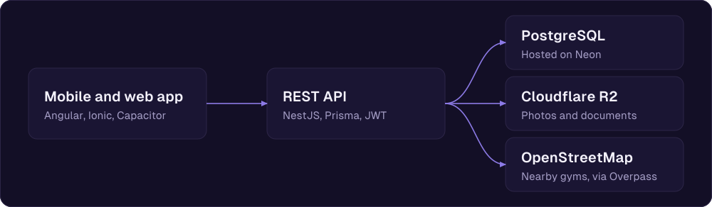

<!-- Perfil de GitHub de DrMunty. Va en el repositorio público DrMunty/DrMunty, en la raíz, como README.md -->

I'm a full-stack developer based in Spain. I'm building **LightWeight**, a fitness app where people plan and log their training, and can hire a coach.

You can find me on [LinkedIn](https://www.linkedin.com/in/albert-muntal-perez) or write to me at [al96@hotmail.es](mailto:al96@hotmail.es).

## LightWeight

A mobile app for people who lift and the coaches who work with them. There is a [live demo](https://beastmode-fitnessapp.vercel.app), and I'm packaging it for Android and iOS with Capacitor. The repositories are private for now, so if you'd like to see the code, write to me.

- **Routines.** A short questionnaire builds the plan: sets, rep range, rest and RIR per set. Then a weekly calendar and a guided workout with a rest timer.
- **Progress.** Session history, evolution per exercise and weekly volume per muscle group.
- **Coaching.** Clients find a trainer and hire a service. Trainers manage their clients and routines, and they chat with text and photos.
- **Nearby gyms.** A map of gyms around you, from OpenStreetMap data.

## How it's built

- **Front end:** Angular, Ionic, Capacitor, Tailwind CSS
- **Back end:** NestJS, Prisma, PostgreSQL
- **Tests:** Vitest on the front end, Jest on the API, plus end-to-end tests over HTTP
- **Deploy:** Vercel, Render, Neon, Cloudflare R2, GitHub Actions

## How I work

- The rules that matter (calculations, permissions, edge cases) are pure functions with their own tests, written before the feature.
- One branch per feature and small pull requests. CI runs the type check, the tests and the build on each one.
- I check every screen at 375 and 320 px, and on an iPhone with a Dynamic Island, because that is where layouts break.
